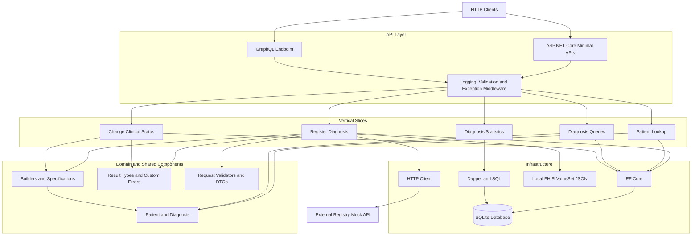
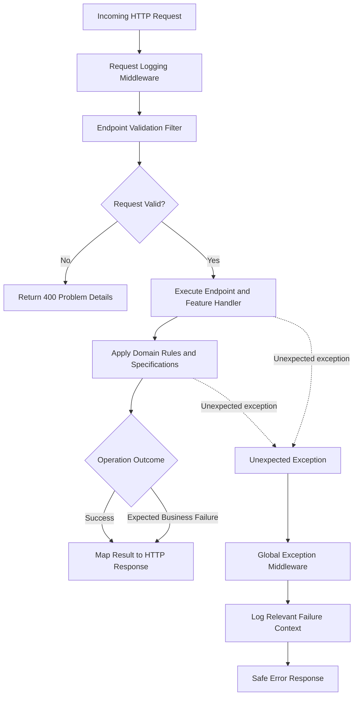
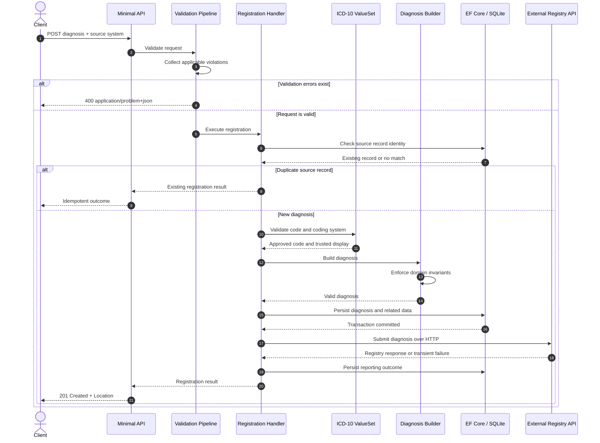
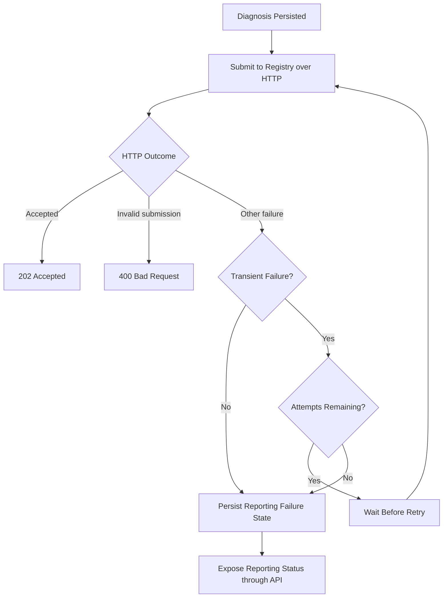
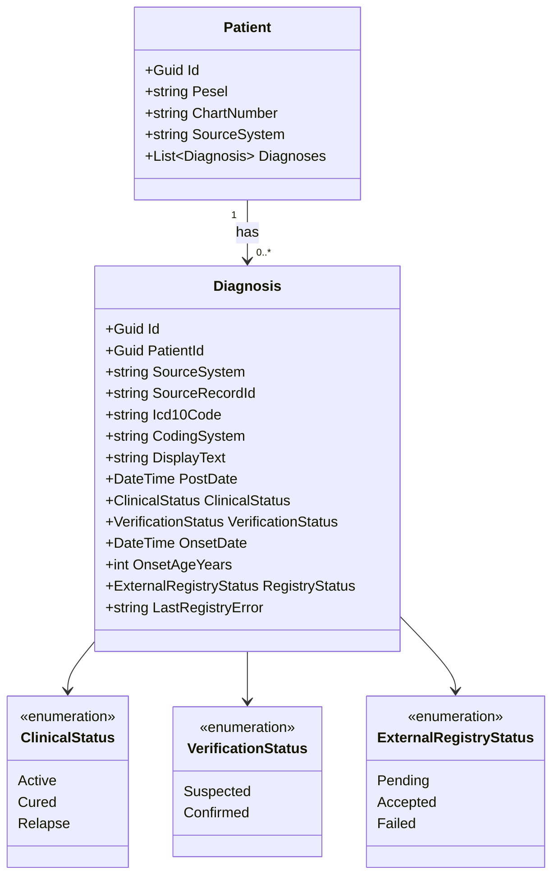
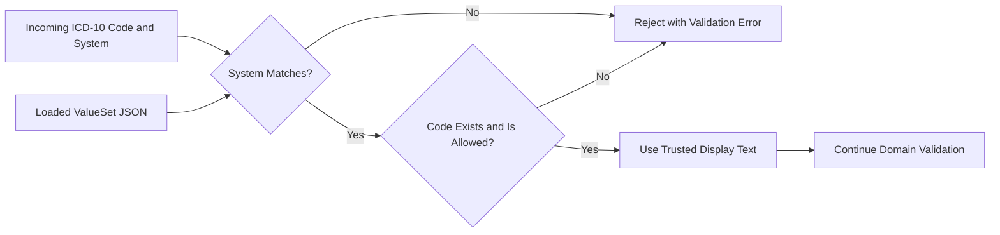

# Clinical Diagnosis Registry API
[](https://dotnet.microsoft.com/)
[-blue)](https://github.com/your-username/DiagnosesRegistry)
> **Quick Summary:**  
> A production-ready .NET backend service that securely ingests, validates, and manages clinical medical records from multiple disparate healthcare systems. It solves real-world data integration challenges such as preventing duplicate entries, ensuring patient identity accuracy across different clinics, validating medical terminology offline, and reliably syncing data with external registries. Built with clean architecture principles to ensure data integrity, auditability, and fault tolerance.

A .NET backend application for registering, validating, querying, and reporting clinical diagnoses across multiple healthcare source systems.

The system addresses data integrity challenges common in healthcare integrations: validating clinical terminology, resolving patient identity across independent systems, preventing duplicate registrations, enforcing domain invariants, and reliably communicating with an external registry.

Built with **C#, ASP.NET Core Minimal APIs, Entity Framework Core, SQLite, Dapper, and GraphQL**, the application demonstrates modern backend engineering practices with a strong emphasis on explicit business rules, predictable error handling, and reliable data processing.

> **Project focus:** Domain integrity, validation, idempotency, resilient HTTP integration, and maintainable API architecture.

## Key Features

- **Clinical diagnosis registration** — registers patient diagnoses with source-system identifiers, ICD-10 codes, clinical status, verification status, and symptom-onset information.
- **ICD-10 terminology validation** — loads a FHIR `ValueSet` from a JSON resource at startup, validates codes locally, and obtains trusted descriptions from the approved terminology dataset.
- **Aggregated validation errors** — collects applicable validation violations and returns them together using `application/problem+json`.
- **Source-aware patient identity** — distinguishes patients from SYS-A and SYS-B, even when both systems use the same medical record number.
- **Idempotent processing** — prevents duplicate diagnoses when the same source record is submitted repeatedly.
- **Reliable external registry integration** — uses a separate HTTP endpoint, bounded retries, transient-failure handling, and observable reporting status.
- **REST and GraphQL APIs** — supports diagnosis registration, patient lookup, diagnosis queries, status changes, statistics, and nested GraphQL queries.
- **Explicit error handling** — implements custom error abstractions, predefined errors, generic and non-generic Result types, and global exception middleware.
- **Controlled domain construction** — uses builders and specifications to enforce entity creation rules and protect domain invariants.
- **Query and command separation** — organizes read and state-changing operations around explicit application use cases without introducing a Mediator.
- **Database-backed reporting** — executes SQL aggregation through Dapper rather than calculating statistics in application memory.
- **Transactional persistence** — uses EF Core with SQLite and database migrations.
- **Bounded pagination** — enforces a maximum page size on collection endpoints.
- **Clinical status transition rules** — rejects prohibited transitions, such as changing a cured diagnosis back to active, with HTTP `409 Conflict`.

---

## Architecture

The application follows **Vertical Slice Architecture (VSA)**. Features are organized around business operations rather than requiring every operation to pass through a fixed set of generic service layers.

Cross-cutting concerns, domain entities, shared error handling, validation infrastructure, and persistence are separated into reusable components.

### Architectural principles and patterns

| Pattern / approach | Application |
|---|---|
| Vertical Slice Architecture | Organizes functionality by use case, such as diagnosis registration, patient lookup, status updates, and statistics. |
| Command pattern | Represents operations that change application state. Commands are passed directly to handlers or application methods. |
| Query pattern | Separates read-oriented operations from state-changing workflows. |
| Result pattern | Represents successful operations and expected business failures explicitly, using generic and non-generic result types. |
| Custom error model | Provides a common error abstraction and predefined errors for consistent failure representation. |
| Builder pattern | Controls the creation of important domain entities and evaluates their creation requirements. |
| Specification pattern | Encapsulates domain rules and validation conditions used during entity construction. |
| FluentValidation | Defines request validation rules and supports reporting multiple violations. |
| DTOs | Separates API contracts from domain entities and persistence models. |
| Middleware pipeline | Centralizes request logging, validation-filter execution, and global exception handling. |
| EF Core | Handles relational persistence, entity mapping, and database migrations. |
| Dapper | Executes the dedicated SQL reporting query. |

**Architecture clarification:** The application uses command and query patterns but does not implement full CQRS. It does not require a Mediator, separate read and write databases, or independently deployed models.

### 1. Application architecture

This diagram illustrates the relationship between API entry points, feature-oriented application logic, domain rules, persistence, and the external registry.



*The diagram represents the logical architecture. Individual slices may use different combinations of shared components and infrastructure.*

### 2. Request processing and error handling

The application distinguishes expected business failures from unexpected technical exceptions. Validation failures are collected and translated into structured HTTP responses, while unexpected exceptions are handled centrally.



Key design decisions:

- Expected business refusals are represented by Result values, not exceptions.
- Validation returns all applicable violations instead of failing at the first one.
- The HTTP layer maps operation outcomes to protocol-level responses.
- Internal exception messages and stack traces are not exposed to clients.
- Logging provides operational visibility without unnecessarily exposing patient-identifying information.

### 3. Diagnosis registration sequence

The registration workflow validates the incoming diagnosis, resolves patient identity, constructs a valid domain entity, persists the diagnosis, and communicates with the separate external registry.



*The sequence shows the intended end-to-end workflow. The implementation should ensure that persistence and external reporting have explicit failure handling, including when the registry remains unavailable.*

### 4. External registry retry flow

The external registry is an independent HTTP service. Its mock implementation returns `503 Service Unavailable` for the first two valid submissions and `202 Accepted` from the third attempt onward. Invalid submissions return `400 Bad Request` immediately.



The retry policy is bounded to a maximum of three attempts and retries only transient failures. Invalid requests and local ICD-10 validation failures are not retried.

If all attempts fail, the diagnosis remains persisted and its unsuccessful reporting outcome remains visible through the API.


## Domain Model

The core domain consists of patients and their diagnoses. Each diagnosis belongs to one patient and contains the clinical information, source identity, and external reporting state needed for reliable processing.

### Patient

A patient contains an internal identifier, a PESEL when available, a medical record number, and its source-system context.

```csharp
public class Patient
{
    public Guid Id { get; set; } = Guid.NewGuid();

    public string? Pesel { get; set; }

    public string ChartNumber { get; set; } = default!;

    public string SourceSystem { get; set; } = default!;

    public List<Diagnosis> Diagnoses { get; set; } = new();
}
```

### Diagnosis

A diagnosis contains clinical information and the source-system identity needed to identify repeated submissions.

```csharp
public class Diagnosis
{
    public Guid Id { get; private set; }

    public Guid PatientId { get; private set; }

    public string SourceSystem { get; private set; } = default!;

    public string SourceRecordId { get; private set; } = default!;

    public string Icd10Code { get; private set; } = default!;

    public string CodingSystem { get; private set; } = default!;

    public string DisplayText { get; private set; } = default!;

    public DateTime PostDate { get; private set; }

    public ClinicalStatus ClinicalStatus { get; private set; }

    public VerificationStatus VerificationStatus { get; private set; }

    public DateTime? OnsetDate { get; private set; }

    public int? OnsetAgeYears { get; private set; }

    public ExternalRegistryStatus RegistryStatus { get; private set; }

    public string? LastRegistryError { get; private set; }

}
```

The private parameterless constructor supports ORM materialization, while controlled construction and state-changing operations protect the entity's invariants.

The model captures several important requirements:

- `SourceSystem` and `SourceRecordId` provide source-record identity for idempotent registration.
- `CodingSystem`, `Icd10Code`, and `DisplayText` represent the validated terminology.
- `OnsetDate` and `OnsetAgeYears` represent alternative symptom-onset formats.
- `ClinicalStatus` and `VerificationStatus` represent distinct clinical concepts.
- `RegistryStatus` and `LastRegistryError` make external reporting outcomes observable.

### Domain model diagram




## Critical Data Integrity and Validation

Healthcare data requires more than basic DTO validation. The system separates request validation, terminology verification, domain invariants, and persistence consistency.

### Clinical diagnosis validation

Before a new diagnosis is accepted, the applicable rules include:

- The diagnosis date must not be in the future.
- The ICD-10 code must exist in the approved terminology resource.
- The coding-system identifier must match the terminology system.
- The stored description must come from the trusted terminology resource, not untrusted client input.
- Symptom onset must be represented by a date or an age in years, never both.
- Required source identifiers and clinical attributes must be valid.

All applicable validation violations are returned together using `application/problem+json`.

### FHIR ValueSet and local terminology

The approved ICD-10 codes are maintained in a static JSON FHIR `ValueSet` resource. It includes a canonical URL, an explicit coding-system identifier, and code/display pairs.

The resource is loaded at application startup so code validation works locally without requiring an external terminology server.

This approach supports:

- Offline code validation.
- Consistent terminology descriptions.
- Rejection of unknown and withdrawn codes.
- Verification of the coding-system identifier.
- Separation of terminology data from application logic.



### Source-aware identity and idempotency

A medical record number is not globally unique across independent source systems.

For example, SYS-A and SYS-B may both have a patient with chart number `12345`, but those records represent different people.

Patient identity therefore uses the appropriate source context and patient identifiers. Diagnosis idempotency is based on the source record identity rather than generating a new diagnosis for every HTTP request.

The persistence design should enforce the appropriate uniqueness constraints so duplicate submissions remain safe under concurrent requests.

### Controlled domain construction

Builders provide a controlled creation path for important domain entities. Specifications encapsulate creation rules and are evaluated before a valid entity is returned.

This complements FluentValidation:

- **Request validation** checks incoming data and reports client-facing violations.
- **Specifications** express reusable business conditions.
- **Builders** control the creation of valid entities.
- **Domain operations** enforce rules for subsequent state changes.


## Error Handling and API Responses

### Result pattern

The application uses a custom Result pattern with generic and non-generic variants.

Expected business failures are represented explicitly, allowing callers to inspect an operation's outcome without using exceptions for ordinary control flow.

A shared custom error abstraction and predefined errors provide consistent error identification and handling.

### HTTP response conventions

| Status | Usage |
|---|---|
| `201 Created` | New diagnosis registered successfully, with a `Location` header. |
| `400 Bad Request` | Invalid input or aggregated validation failures. |
| `409 Conflict` | Prohibited clinical status transition. |
| `503 Service Unavailable` | Temporary rejection from the external registry. |
| `202 Accepted` | The mock registry accepts a submission for processing. |

A duplicate registration must not create another diagnosis or become an unexpected server error. Its response behavior should be consistent with the chosen idempotency contract.

### Global exception middleware

Unexpected exceptions are handled centrally. The middleware prevents internal exception details and stack traces from leaking to API consumers.

Validation errors use the `application/problem+json` content type. Expected business refusals remain ordinary Result values, translated into HTTP responses by the endpoint layer.

### Logging middleware

Request logging provides consistent visibility into request execution and failures.

Logging should avoid unnecessary patient-identifying information, credentials, and other sensitive data. Operational context should be sufficient to diagnose failures without exposing confidential clinical details.


## REST API

The REST interface exposes the principal clinical workflows:

- Register a diagnosis with source-system context.
- Retrieve a patient's diagnoses.
- Filter diagnoses by clinical status.
- Sort diagnoses by diagnosis date.
- Search for a patient by PESEL or medical record number.
- Update the clinical status of a diagnosis.
- Inspect external registry reporting status.
- Retrieve diagnosis statistics grouped by ICD-10 code.

Successful diagnosis creation returns `201 Created` with a `Location` header.

Collection endpoints use pagination and enforce a hard maximum page size on the server. Client-supplied pagination values cannot bypass the configured limit.

### Clinical status transitions

Clinical status changes are governed by explicit domain rules. A transition from *Cured* to *Active* is prohibited and returns HTTP `409 Conflict`.

The rule belongs to the domain/application operation rather than being implemented solely as a request-validation rule.


## GraphQL API

The same underlying domain model is exposed through a GraphQL endpoint.

The API supports:

- A nested query that traverses from a patient to their diagnoses and then to the corresponding ICD-10 code.
- A mutation for changing or registering a diagnosis according to the implemented schema.
- Business refusals represented in the response data rather than as unhandled exceptions.

REST and GraphQL expose different API contracts while sharing the underlying domain rules and persistence behavior.


## Database and Persistence

### Entity Framework Core and SQLite

EF Core manages ordinary entity persistence and relational mappings.

The database is initialized through EF Core migrations rather than `EnsureCreated`. Related database changes are committed in a transaction where required to preserve consistency.

### Dapper and SQL reporting

Diagnosis statistics are calculated using a dedicated SQL query executed through Dapper.

The query groups diagnoses by ICD-10 code, counts the records, and sorts the results in descending order.

```sql
SELECT
    Icd10Code,
    COUNT(*) AS DiagnosisCount
FROM Diagnoses
GROUP BY Icd10Code
ORDER BY DiagnosisCount DESC;
```


This reporting operation is deliberately performed in SQL, rather than loading all diagnoses into application memory or calculating the aggregation through EF Core.


## Technology Stack

| Technology | Purpose |
|---|---|
| C# / .NET | Application and domain logic |
| ASP.NET Core Minimal APIs | REST endpoints and HTTP request handling |
| GraphQL | Nested queries and mutations |
| FluentValidation | Request validation and aggregated violations |
| Custom Result pattern | Explicit representation of expected operation outcomes |
| Builder pattern | Controlled construction of domain entities |
| Specification pattern | Reusable domain validation rules |
| Entity Framework Core | ORM and relational persistence |
| SQLite | Relational database |
| EF Core Migrations | Database schema evolution |
| Dapper | SQL-based diagnosis statistics |
| FHIR `ValueSet` JSON | Local ICD-10 terminology resource |
| HTTP Client | Communication with the mock external registry |
| ASP.NET Core Middleware | Logging, validation integration, and global exception handling |


## Testing and Edge Cases

The test dataset covers the key business requirements and deliberately includes invalid or ambiguous scenarios.

| Scenario | Expected outcome |
|---|---|
| Valid diagnosis registration | Persist diagnosis and return `201 Created` with `Location`. |
| Multiple simultaneous validation violations | Return `400` with all applicable violations. |
| Future diagnosis date | Reject the registration. |
| Unknown ICD-10 code | Reject the registration. |
| Withdrawn ICD-10 code | Reject according to the terminology policy. |
| Incorrect coding system | Reject the registration. |
| Untrusted description supplied by client | Use the approved terminology description. |
| Both onset date and onset age supplied | Reject the invalid combination. |
| Same source record submitted twice | Do not create a duplicate diagnosis. |
| Same chart number in SYS-A and SYS-B | Resolve the patients independently. |
| First two valid registry submissions | Return `503` from the mock registry. |
| Third valid registry submission | Return `202` from the mock registry. |
| Invalid registry submission | Return `400` immediately, without retries. |
| Registry unavailable after three attempts | Preserve the diagnosis and expose reporting failure. |
| Cured diagnosis changed to Active | Return `409 Conflict`. |
| Excessive requested page size | Enforce the server-side maximum. |
| Diagnosis statistics | Execute SQL aggregation through Dapper. |
| GraphQL business refusal | Return the refusal as response data. |


## Engineering Highlights

### Correctness over superficial CRUD

The system is designed around the integrity of clinical data, including source-aware identity, terminology validation, idempotency, and controlled state transitions.

### Explicit business outcomes

Custom Result types and predefined errors make expected refusals part of the application contract. HTTP endpoints translate those outcomes into appropriate status codes without using exceptions for routine business decisions.

### Validation at the appropriate boundaries

FluentValidation, specifications, builders, and domain operations have distinct responsibilities. This provides clear separation between incoming request validation and the invariants required by the domain model.

### Reliable integration

The external registry is accessed over HTTP, retry behavior is bounded, and reporting failures remain observable without discarding a successfully persisted diagnosis.

### Fit-for-purpose data access

EF Core handles normal persistence, while Dapper executes the required SQL aggregation directly in the database.

### Maintainable architecture

Feature-oriented organization, DTOs, shared infrastructure, explicit errors, and controlled domain construction make business rules easier to find, review, and test.
